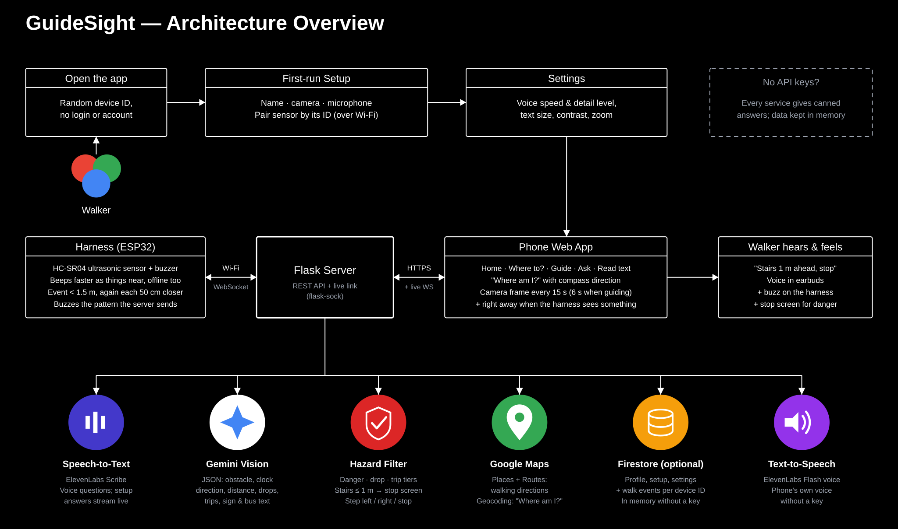
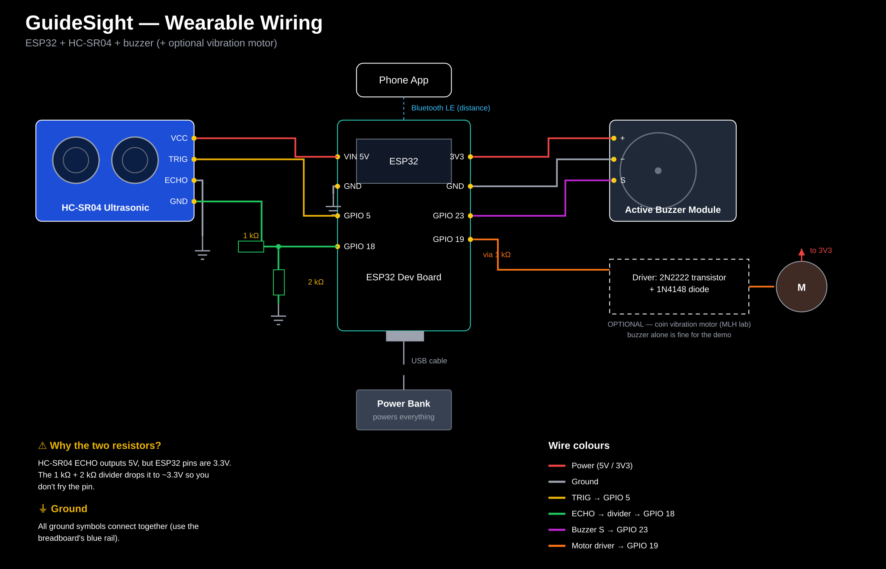

<div align="center">
  <h1 style="font-size:48px; margin-bottom:0;">GuideSight</h1>
  <h3>Obstacle alerts and spoken guidance for walkers with guide dogs</h3>
  <br>
  
  
  
  
  
  
  
  
  
  <br><br>
</div>

Assistive walking companion for blind and low-vision people who use guide dogs. An ultrasonic
sensor on the harness spots obstacles ahead and tells the server over Wi-Fi. The walker's phone snaps
a frame, Gemini describes what's ahead, and the walker hears a short warning in their earbuds and
feels a buzz on the harness handle.

Built for HackCamp 2026.

## Features

- **Obstacle sensing** — ultrasonic sensor on the harness buzzes the handle as things get closer, even offline.
- **Scene description** — Gemini Vision looks at the phone's camera and describes what's ahead.
- **Guide mode** — spoken turn-by-turn walking directions via Google Maps.
- **Ask mode** — voice or typed questions, answered aloud (ElevenLabs, or the phone's built-in voice).
- **Read mode** — reads text from signs, menus, and buses aloud.
- **No login** — each phone gets a random device id on first open; no account to set up.

## Built with

- Flask + flask-sock server, Firestore (`firebase-admin`) for storage — optional, falls back to in-memory.
- `google-genai` (Gemini Vision) for scene description.
- ElevenLabs for speech-to-text (questions) and text-to-speech (spoken alerts).
- Google Maps — Places API (New) + Routes API — for walking directions.
- React + Vite + Tailwind v4 walker web app.
- ESP32 (or Arduino UNO R4 WiFi) + HC-SR04 ultrasonic sensor + buzzer firmware.

## Architecture Overview



```
 ESP32 harness        ──Wi-Fi──▶ Flask server ──▶ Gemini Vision / ElevenLabs / Firestore
 (HC-SR04, buzzer)   ◀──buzz───┘   ▲     │
                                   │     └──live events──▶ walker web app on the phone (/walk)
                    frames, voice ─┘                        (camera, mic, GPS, speech)
```

| Folder              | What                                                              | Stack |
|---------------------|-------------------------------------------------------------------|-------|
| `server/`           | API: profile & first-run setup, walks, frames, voice/typed questions, walking directions, TTS, live harness link | Flask, flask-sock, firebase-admin (Firestore), google-genai, Google Maps (Places + Routes), ElevenLabs |
| `dashboard/`        | Walker web app: voice or typed first-run setup → walker app (Home, Where to?, Guide mode with spoken turn-by-turn directions, Read text, Settings). No login | React, Vite, Tailwind v4 |
| `firmware/esp32/`   | Obstacle detection, proximity beeps, buzz patterns, Wi-Fi link   | ESP32 Dev Module, ArduinoHttpClient |

## Getting Started

### Prerequisites

- [Python](https://www.python.org/) 3.10+ and pip.
- [Node.js](https://nodejs.org/) and npm.
- (optional, for the harness) Arduino IDE.

### Quick start (mock mode, no API keys)

Every external service falls back to canned responses when its key is blank, and data is kept in memory.

```bash
# 1. Server
cd server
python3 -m venv .venv && .venv/bin/pip install -r requirements.txt
cp .env.example .env
.venv/bin/python run.py                 # http://localhost:5001
.venv/bin/python -m pytest              # API tests

# 2. Web app (walker app + dashboard). Vite forwards /api to the server.
cd dashboard && cp .env.example .env && npm install && npm run dev
#   http://localhost:5173/walk  walker app (add ?demo for the prototype's sample content, #d4 etc. to open a screen)
```

### On a phone

Phone browsers only allow the camera, microphone and GPS on `https://` pages, so open the app
through a tunnel instead of the laptop's IP:

```bash
brew install cloudflared
cloudflared tunnel --url http://localhost:5173   # prints https://<random>.trycloudflare.com
```

Open `https://<random>.trycloudflare.com/walk` on the phone. For a home-screen icon: Safari → Share →
Add to Home Screen. Keep the page open with the screen on during a walk (it holds a wake lock).
On iPhones, tap the first screen (**Tap anywhere to start**) yourself: Safari only lets a page speak after a tap.

## Harness (ESP32)



| From | To ESP32 (pins printed as D5, D18...) |
|---|---|
| HC-SR04 VCC / GND | VIN (5 V) / GND |
| HC-SR04 TRIG | D5 |
| HC-SR04 ECHO | 1 kΩ → D18, plus 2 kΩ from D18 to GND (ESP32 pins are 3.3 V) |
| Buzzer + / − / S | 3V3 / GND / D23 |
| Vibration motor (optional) | D19 → 1 kΩ → 2N2222 base, 1N4148 across the motor |

1. Arduino IDE: install the **esp32 by Espressif** core and the **ArduinoHttpClient** library.
2. Copy `firmware/esp32/arduino_secrets.example.h` to `arduino_secrets.h` and fill in:
   - **Wi-Fi**: 2.4 GHz only, no username/password networks like eduroam. A phone hotspot works
     (iPhone: turn on **Maximize Compatibility**).
   - **Server**: for dev, put the laptop on the same hotspot and use its IP with port `5001` and
     `SERVER_TLS 0`. For a deployed server or a tunnel, use its host name, port `443`, `SERVER_TLS 1`.
   - **HARNESS_ID**: something unique, like `gs-7f3k9q`.
3. Pick "ESP32 Dev Module" and upload. Serial Monitor at 115200 shows Wi-Fi, server and events.
   The blue LED on the board is on while it's connected to the server.
4. In the walker app, open **Settings → Sensor** (or **Enter sensor ID** on the Connect your sensor step), type the
   same harness ID and tap **Save**, then **Test buzz**.

The harness beeps faster as things get closer even when it's offline. Online, it tells the phone when
something comes within 1.5 m and again each 50 cm closer, so the walker hears the distance count down. Obstacle events and buzz
commands need the server link.

### Arduino UNO R4 WiFi instead of the ESP32

`firmware/uno_r4/` is the same firmware for a UNO R4 WiFi (board **Arduino UNO R4 Boards** core,
plus **ArduinoHttpClient**), using `firmware/uno_r4/arduino_secrets.example.h`. The built-in LED is
on while it's connected. On Apple Silicon Macs the R4 core's compiler needs Rosetta:
`softwareupdate --install-rosetta --agree-to-license`.

| From | To UNO R4 WiFi |
|---|---|
| HC-SR04 VCC / GND | 5V / GND |
| HC-SR04 TRIG / ECHO | D9 / D10 (no resistors needed, the R4 is 5 V) |
| Buzzer + / − / S | 3.3V / GND / D8 |

## Going live

1. **Firestore** (storage): create a Firebase project with Firestore, download a service-account JSON
   (Project settings → Service accounts) and set `GOOGLE_APPLICATION_CREDENTIALS` to its path.
   Blank = in-memory storage.
2. **Harness key**: set `HARNESS_KEY` in `server/.env` and the same value in `arduino_secrets.h`.
   Blank = any harness may connect.
3. **Gemini**: set `GEMINI_API_KEY`. `GEMINI_MODEL` defaults to `gemini-flash-latest`.
4. **ElevenLabs** (speech-to-text for questions, text-to-speech for spoken alerts): set `ELEVENLABS_API_KEY`.
   `ELEVENLABS_STT_MODEL` defaults to `scribe_v2`, `ELEVENLABS_TTS_MODEL` to `eleven_flash_v2_5`, and
   `ELEVENLABS_VOICE_ID` to a premade voice. Without a key, the app speaks with the phone's built-in voice.
5. **Google Maps** (walking directions in Guide mode): in Google Cloud console, enable **Places API (New)**
   and **Routes API**, create an API key and set `GOOGLE_MAPS_API_KEY`. The key stays on the server.
   Without a key, any destination gets a made-up 200 m route starting where you stand.
6. **Hosting**: the web app is static (`npm run build` → `dashboard/dist`); route every path to
   `index.html` so `/walk` loads. If the server is on another host, set `VITE_API_URL` and add the web
   app's origin to `CORS_ORIGINS`. Run the server as a **single process** with threads (for example
   `gunicorn -w 1 --threads 32`): live connections are kept in memory.

## API

There is no login. Each phone makes a random device id on first open (`dashboard/src/lib/device.ts`)
and every route needs `Authorization: Bearer <device id>`; that id is the user id. Ids are 8–64
letters, digits, `-` or `_`. Clearing the site's data on the phone starts over as a new user.

| Method & path                         | Body                                              | Returns                         |
|---------------------------------------|---------------------------------------------------|---------------------------------|
| `GET  /api/me`                        | –                                                 | `{id, profile, setup, settings, next_step}` |
| `PUT  /api/me`                        | `{name?, email?}`                                 | same as `GET /api/me`           |
| `PUT  /api/setup/:step`               | camera/microphone: `{status: "allowed"\|"skipped"}`, sensor: `{status: "skipped"}` | same as `GET /api/me` |
| `GET  /api/setup/sensor`              | –                                                 | `{harness_id, online, nearby: [{id, same_network}]}` |
| `POST /api/setup/sensor`              | `{harness_id}`                                    | `{harness_id, online, buzzed, me}`, buzzes the sensor |
| `POST /api/setup/complete`            | –                                                 | same as `GET /api/me`           |
| `POST /api/routes`                    | `{origin: {lat, lng}, destination: "Tim Hortons" \| {lat, lng, name?}}` | `{destination: {name, address, location}, distance_m, duration_s, steps: [{instruction, maneuver, distance_m, points, ...}]}`; 404 = not found |
| `POST /api/walks`                     | –                                                 | `{id, started_at, ...}`         |
| `POST /api/walks/:id/harness-event`   | `{type: "obstacle"\|"stop"\|"pull", motion, location}` | `{event, capture_frame}`   |
| `POST /api/walks/:id/frame`           | `{image: base64 jpeg, trigger, location}`         | `{alert, scene}`, buzzes the harness. `alert.obstacle` = `{what, distance_m, clock}`, `alert.avoid` = `left\|right\|stop\|none` |
| `POST /api/walks/:id/voice`           | multipart: `audio`, optional `image`, `lat`, `lng`| `{transcript, alert}`           |
| `POST /api/walks/:id/end`             | –                                                 | walk                            |
| `POST /api/tts`                       | `{text, speed}`                                   | `audio/mpeg` clip; 503 without an ElevenLabs key |
| `GET  /api/walks/:id`                 | –                                                 | `{walk, events}`                |
| `GET/PUT /api/settings`               | voice, alert & accessibility preferences, `harness_id` | settings                   |
| `GET  /api/harness/status`            | –                                                 | `{harness_id, online}`          |
| `POST /api/harness/buzz`              | `{pattern: "short"\|"double"\|"long"}`            | `{delivered}`                   |

Errors come back as `{error: "<reason>"}`.

### First-run setup

The server tracks setup progress per user. `GET /api/me` returns `next_step`, the step still to do:

| `next_step`  | Screen                                   | Answered with |
|--------------|------------------------------------------|---------------|
| `name`       | "What should Sighty call you?"           | `PUT /api/me {name}` |
| `camera`     | "Let Sighty see ahead"                   | `PUT /api/setup/camera {status}` |
| `microphone` | "Talk to Sighty"                         | `PUT /api/setup/microphone {status}` |
| `sensor`     | "Connect your sensor" (poll `GET /api/setup/sensor` while searching) | `POST /api/setup/sensor {harness_id}` or `PUT /api/setup/sensor {status: "skipped"}` |
| `finish`     | "You're all set"                         | `POST /api/setup/complete` |
| `null`       | Home                                     | – |

Camera and microphone permissions live in the browser; the server only records the answer so setup
resumes where it left off. `nearby` lists switched-on sensors no one has paired yet, ones on the same
network as the phone first. Any user can pair an unpaired sensor; a paired one can't be taken.

Settings also hold the accessibility options: `text_size` (`default`|`large`|`extra_large`),
`high_contrast`, `read_screen_aloud`, `zoom`, `voice_control`, plus `speech_rate` (0.5–2.0) and
`haptics_enabled` ("Vibration alerts").

`alert` is `{speak, urgency, haptic: "short"|"double"|"long"|null, speech_rate}`. The phone speaks it
with the browser's speech synthesis; the server sends `haptic` straight to the harness.

## Live link (WebSockets)

Defined in `server/app/live.py`. The first message on each socket authenticates it.

- `/api/harness/ws` (harness):
  - harness → server: `{"type":"hello","id":"gs-…","key":"…"}`, then `{"type":"obstacle","cm":85}`
    and `ping` every 15 s
  - server → harness: `short` | `double` | `long` (buzz), or `pong`
- `/api/live` (walker app):
  - phone → server: `{"type":"auth","token":"<device id>"}`, then `ping` every 25 s
  - server → phone: `{"type":"harness_event","event":{...}}` and `{"type":"harness_status","online":true}`

A harness belongs to the user whose settings have its `harness_id`.

## Firestore layout

```
users/{uid}                                  { profile, setup, settings }   uid = device id
users/{uid}/walks/{walkId}                   { started_at, ended_at, stop_count, pull_count }
users/{uid}/walks/{walkId}/events/{eventId}  { type: obstacle|stop|pull|alert|question, at, location, ... }
```

## Main TODOs

- [ ] Calibrate `OBSTACLE_CM` / `CLEAR_CM` in `firmware/esp32/esp32.ino` on a real harness.
- [ ] Hands-free voice (wake word / voice activity detection) instead of tap-to-ask.
- [ ] Background operation: keep the walk running with the screen locked.
